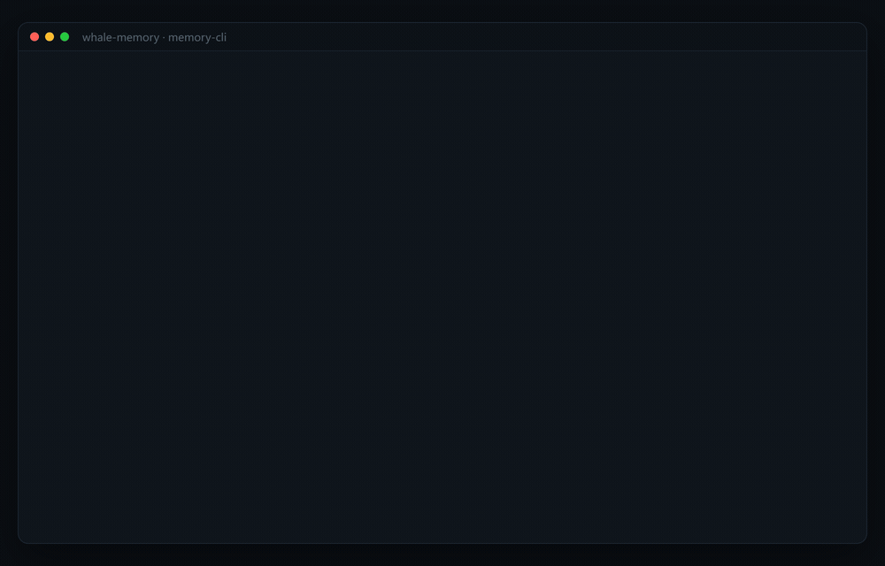

# Whale-memory · an autobiographical memory for an AI companion

**Write the past of an AI character.** What she thought then, how she changed her mind later —
old views are never overwritten, changes are only appended.

She read a chapter yesterday and changed her mind today. Can she still go back to the person she was yesterday?

That is what this project makes possible.

[中文](README.md) · [English](README.en.md) · [All English docs](docs/en/README.md)

[](https://github.com/firefly1office/whale-memory/actions/workflows/check.yml)

## Thirty seconds

Node.js 20 or newer, from the repository root. Offline, no API key, data goes to `./data`:

```sh
git clone https://github.com/firefly1office/whale-memory.git
cd whale-memory
node adapters/cli/memory-cli.mjs write --text "Read the opening; closed the book wondering: does the lighthouse keeper keep the light alone because he is afraid of the dark?" --thought "I thought he was afraid of the dark."
node adapters/cli/memory-cli.mjs revise --id <the id printed above> --thought "She is keeping the light for the boats that come back late."
node adapters/cli/memory-cli.mjs read --id <id>
```



One reading note; she changed her mind later. `--as-of` takes you back to what she thought first.

## Numbers

| | |
|---|---|
| Fabrication rate | **0** — ask for a detail that was never recorded and it says so; 0 on both dev and holdout sets |
| Recall (strict, top-1) | 92.9% dev · 73.1% holdout |
| Sealed / unsaid exposure | 1250 checks (125 surfaces × 10 markers), **0** exposures |
| Tests | 372, CI runs ubuntu / windows × node 20 / 22 |

`npm run eval` reproduces it; thresholds live in CI and fail the build. The eval corpus is only
33 synthetic experiences — [what it cannot measure](docs/en/eval.md) is documented too. Do not read this
table as general accuracy.

## What it does not do

- **No user profiling.** It stores her experiences, not a dossier about you.
- **No guessing.** If it was not recorded, it says so.
- **No volunteering of sealed or unsaid things.** "Not mentioned" is not "deleted".

> Known issues and trade-offs: [docs/pitfalls.md](docs/en/pitfalls.md) — literal-matching recall,
> a thin margin on the strict threshold, single-writer assumption, small eval corpus.

## One record

```json
{ "day": "2026-11-14",
  "then": { "text": "Read the scene at the clubroom door", "thought": "If he doesn't say it now, nothing is left" },
  "later": [{ "at": "2026-11-15T09:12:00Z", "thought": "Now I think he was protecting a friend" }] }
```

`then` is fixed once written; `later` is append-only. Full schema: [docs/schema.md](docs/en/schema.md).

## Where data lives, what to back up

Records live under `<WHALE_DATA_DIR>/plugin-data/biomimetic-memory/`. On disk `then` is in
`self-experience.jsonl` and later thoughts are in `later-events.jsonl`; they are merged at read time.
Back up both (plus `recall-events.jsonl`). Full list: [docs/backup.md](docs/en/backup.md).

## See an experience change its mind

Node.js 20+ (CI runs 20 and 22). Run from the repository root; the demo uses a temporary directory, works offline, and needs no API key.

```sh
git clone https://github.com/firefly1office/whale-memory.git
cd whale-memory
node packages/core/demo.mjs
```

Output follows your system language (English unless your locale is Chinese); force it with `node packages/core/demo.mjs --lang en`. The CLI and the MCP server take the same `--lang en|zh` flag (or `WHALE_LANG`), and error messages are always English first.

In the "[after changing her mind]" section, look for the original thought and the later one. Both belong to the same experience. The demo prints the data directory at the end.

## Write your first experience

Run from the repository root. By default it writes to `./data/`. For real use, give each character its own `WHALE_DATA_DIR` and keep writes to one directory sequential.

```sh
node adapters/cli/memory-cli.mjs write --text "Read the lighthouse chapter today" --thought "Is the keeper afraid of the dark?"
node adapters/cli/memory-cli.mjs recall --query "lighthouse" --limit 1
```

The first command returns an `id`. Replace `RETURNED_ID` below with it, then read again to see both views.

```sh
node adapters/cli/memory-cli.mjs revise --id RETURNED_ID --thought "The ending made me think she wanted the boats to see the light"
node adapters/cli/memory-cli.mjs read --limit 1
```

## Choose how to integrate

| What you want | Where to start |
| --- | --- |
| Let DSH read and write experiences through commands | [Standalone DSH skill and install notes](examples/dsh-plugin/dsh-whale-memory/README.md) |
| Add tools to your own agent | [CLI adapter](adapters/README.md) — emits JSON; the host decides when to call it |
| Plug into an MCP client (Claude Desktop, Claude Code, Cursor…) | [MCP adapter](adapters/mcp/README.md): `npx -y -p whale-memory-core whale-memory-mcp --data <dir>` — stdio, local only, zero dependencies |
| See what she changed her mind about this month | `changed --days 30`: then and later, side by side |
| Skip writing "when should this be injected" | `surface()` from `whale-memory-core/injection`: one-to-one only, 24-hour de-dupe, recorded only when actually shown |
| Start from a working host | [80-line reference host](examples/reference-host/host.mjs) |
| Use it directly from JavaScript | [Self-layer core](packages/core/README.md) (`npm install whale-memory-core`) and [porting guide](docs/en/porting.md). Mind the `-core`: the unscoped `whale-memory` package on npm belongs to someone else and is unrelated |
| Wire up a character from scratch | [30-minute tutorial](docs/en/tutorial.md): write, recall, change your mind, wake up the next day, seal, her book, plug into a host |
| Inspect the data format | [Schema](docs/en/schema.md) and [fictional samples](examples/samples/) |
| See another host surface yesterday | [First day, still connected the next](examples/first-day/): two processes, no recall command |
| Look back at who she was that day | `read --id <id> --as-of 2026-11-15`: only notes and choices written up to that day are visible |
| Record how it feels now, and what a reflection is based on | `revise --feeling relieved` (the original feeling never changes); `write --refs id1,id2` (every cited experience must exist) |
| Vector/RAG for finding, this for telling | [Composing with a retrieval layer](docs/en/composition.md): retrieval returns ids; `then/later` holds the narrative |
| She no longer wants to be reminded of something | `seal --id`: never recalled or shown on waking, but still on disk; `unseal` brings it back |
| Material for writing a reflection | `recap --days 7`: what she wrote, revised, felt differently about, settled, or left open; facts only, with ids to cite |
| She realizes two things are related | `link --from A --to B --reason "..."`: she links them herself and says why; nothing is linked automatically |
| Name a period of her life | `chapter open --name "..." --from 2026-11-01`; renames keep the old names, and looking back shows what she called it then |
| Print her autobiography | `book --out her-book.md`: grouped by chapter; original entries verbatim, later notes after; sealed entries left out |
| Things she could not say | `unsaid leave --kind draft --text "..."`: drafts she did not send, questions she did not ask, things she held back; visible only via `unsaid list` in a one-on-one chat, never injected |
| One-step backup and restore drill | `node tools/backup.mjs --data <root> --out <dir>`, `node tools/restore-check.mjs --from <backup> --data <root>` ([runbook](docs/en/runbook.md), Chinese) |
| Backup and move machines | [Backup & migration](docs/en/backup.md): seven files plus her drawer, and how to verify after restore |
| How far it goes, what it won't do | [Limits & non-guarantees](docs/en/limits.md): measured scale, plaintext storage, deletion semantics |
| Read before integrating | [Known pitfalls](docs/en/pitfalls.md): lexical recall, single writer, sealing is not deletion, host must enforce the owner gate |
| Read the technical report | [whale-memory technical report](docs/paper/README.md) (Chinese PDF, 28 pages; not peer-reviewed) |
| Is it accurate, does it make things up, does it leak | [whale-eval](docs/en/eval.md): `npm run eval`; dev and held-out sets reported separately; leaks and rewrites must be zero |
| Who can reach her memory, and how we guard it | [Threat model](docs/en/threat-model.md) |
| When to hand a memory back | [Injection timing](docs/en/injection.md): seven rules, a minimal implementation, anti-patterns |
| Where these ideas come from | [What we borrowed, what we changed, what we refuse to do](docs/en/related-work.md) |
| Understand the design | [Architecture](docs/en/architecture.md): layers, evidence policy, recall and write constraints |
| Check evidence rules | [Evidence policy (runnable subset)](docs/en/evidence.md): as-of, supersession, absence |

> The full engine (vault storage, evidence policy, consolidator, injection budget — about 26k lines) is tightly coupled to one host deployment and is **not distributed with this repository**. The design is written up in [architecture.md](docs/en/architecture.md).

## Data and verification

The current interaction experiment prioritizes conversational rhythm: [20 fictional A/B cases and a randomized blind-review page](examples/conversation-rhythm/README.md) (Chinese). It compares ordinary character prompting with concise, selective replies without list-like summaries. Human ratings are pending; memory storage and live characters are unchanged.

For direct emotion API calls, `settle` and `admits` default to `legacy-high`; the evaluator explicitly uses `boundary-v2`. New events and clarifications share admission rules, while medium-confidence clarifications cannot undo or soften existing harm. Reports distinguish blocked incorrect proposals from blocked correct ones against the frozen development rubric.

An experimental [text-emotion module](packages/emotion/README.md) (Chinese) separates contextual interpretation, personal feelings and relationship settlement, with append-only corrections. It is not deployed to a live character and has no validated misjudgment rate. Development cases are not a held-out benchmark. Evaluation reports separate model proposals from applied changes; the unverified `responseHint` output has been removed from the current API.

Experiences live in `<WHALE_DATA_DIR>/plugin-data/biomimetic-memory/`. Records in one directory are read by the calling process. If you expose this over group chats, the host must check who is calling and what that conversation is allowed to see — especially before enabling diary reads. The CLI is meant for trusted local processes.

`tools/` contains development and operations scripts; some connect to a running host, read conversations, or call a model — see [tools/README.md](tools/README.md) (Chinese) for which ones run standalone. The demo above is enough for a first look. These two checks use synthetic data:

```sh
node --test tests/public-cli.test.mjs
node tools/privacy-canary.mjs
```

MIT licensed — see [LICENSE](LICENSE). Before contributing, read [CONTRIBUTING.md](CONTRIBUTING.md); changes are in [CHANGELOG.md](CHANGELOG.md); privacy and safety in [SECURITY.md](SECURITY.md).
