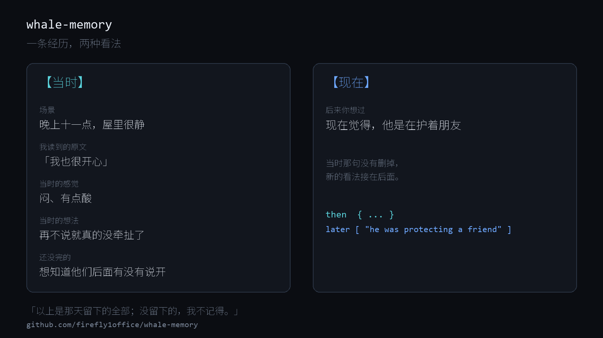

# whale-memory · AI 角色的自传性记忆

[中文](README.md) · [English](README.en.md)

[](https://github.com/firefly1office/whale-memory/actions/workflows/check.yml)



> 图里是**宿主读到的一条经历**：磁盘上 `then` 在 `self-experience.jsonl`，后来追加的想法在 `later-events.jsonl`，读取时才合并成这个样子。备份请把这两个文件（以及 `recall-events.jsonl`）一起带上。

一个 AI 角色的自传性记忆：她当时怎么想、后来怎么改。零依赖、纯 JSONL、可以嵌进任何宿主。鲸鲸是它最初的使用者——一个在 QQ 里生活的角色，这个项目最初就想解决她的一个问题：如果她昨天读了一章书，今天改变了看法，她还能翻回昨天的自己吗？

鲸鲸可以给自己写一条经历，留下当时读到的文字、感受和想法。以后再读到相关段落，她可以找到那一页，为它添上新的看法。记录分为 `then`（当时留下的内容）和 `later`（后来追加的想法）。什么时候值得记，由接入的角色和宿主决定。

一条经历在文件里是这样的（一条一行 JSON）：

```json
{
  "day": "2026-11-14",
  "then": {
    "text": "读到社办门口那段，有点替他难受",
    "scene": "晚上十一点，屋里很静",
    "feeling": ["闷", "有点酸"],
    "thought": "再不说就真的没牵扯了",
    "quote": { "text": "我也很开心", "source": "《败北女角太多了》第3章" }
  },
  "later": [
    { "at": "2026-11-15T09:12:00Z", "thought": "现在觉得，他是在护着朋友" }
  ],
  "weight": "important"
}
```

`then` 写下就固定，`later` 只往后加——所以旧看法不会被新看法覆盖。

## 先看一次改主意

用 Node.js 20 或更新版本（CI 跑 20 与 22），在仓库根目录运行下面的命令。演示使用临时目录和示例经历，可以离线运行，无需 API 密钥。

```sh
git clone https://github.com/firefly1office/whale-memory.git
cd whale-memory
node packages/core/demo.mjs
```

在输出的「改主意后」一节，找到「当时的想法」和「后来你想过」。两句话属于同一条经历。末尾会打印数据目录，方便你查看实际保存的内容。

## 写自己的第一条经历

在仓库根目录运行。默认会写入当前目录的 `data/`。要长期使用，请为每个角色设置独立的 `WHALE_DATA_DIR`，并且不要让两个宿主进程同时写同一个目录（事件追加有锁，经历追加没有；导出、导入前先停宿主）。

```sh
node adapters/cli/memory-cli.mjs write --text "今天读了灯塔那一章" --thought "守灯人是怕黑吗"
node adapters/cli/memory-cli.mjs recall --query "灯塔" --limit 1
```

第一条命令会返回经历的 `id`。把下面的 `返回的ID` 换成它，再读一次就能看见新旧两种想法。

```sh
node adapters/cli/memory-cli.mjs revise --id 返回的ID --thought "读到结尾才知道，她是想让晚归的船看见灯"
node adapters/cli/memory-cli.mjs read --limit 1
```

**先体检一次**（能力层，不是“文件在不在”）：

```sh
node adapters/cli/memory-cli.mjs doctor
```

它会真的在临时目录里写入、读回、结案、导出再导入，再检查事件文件和醒来白名单。`ok: true` 才算能用。

## 选择接入方式

| 你想做什么 | 从哪里开始 |
| --- | --- |
| 让 DSH 通过命令读写经历 | [可独立复制的 DSH skill 和安装说明](examples/dsh-plugin/dsh-whale-memory/README.md) |
| 给自己的 Agent 接入工具 | [命令行适配器](adapters/README.md)输出 JSON，由宿主决定何时调用 |
| 接到 Claude Desktop / Claude Code / Cursor 等 MCP 客户端 | [MCP 适配器](adapters/mcp/README.md)：`npx -y -p whale-memory-core whale-memory-mcp --data <目录>`，stdio、只在本机、零依赖 |
| 在 JavaScript 中直接读写 | [自传层内核](packages/core/README.md)（`npm install whale-memory-core`）和[宿主移植指南](docs/porting.md)。注意包名带 `-core`：npm 上不带 `-core` 的 `whale-memory` 是别人的包，和本项目无关 |
| 从零开始接一个角色 | [30 分钟教程](docs/tutorial.md)：写下、想起、改主意、第二天醒来、封存、她的书、接进宿主 |
| 看数据结构 | [数据格式 schema](docs/schema.md) 与[虚构样本](examples/samples/) |
| 用虚构经历试验情感回想 | [一件事对我意味着什么](examples/emotion-bridge/) 允许同件事涉及不同愿望，分别查看当时的感受和后来的理解 |
| 看别人的宿主怎么接 | [第一天的故事，第二天还接得上](examples/first-day/)：两个进程，隔天自动递回，不输入 recall |
| 翻回那天的自己 | `read --id <id> --as-of 2026-11-15`：只看那天之前写下的后记和选择，之后的都看不见（[语义](docs/schema.md#翻回那天的自己0120-起)） |
| 问一件事的细节 | `detail --query "那条围巾是什么颜色"`：只给原文和证据状态（supported/related/ambiguous/unmatched），不补没写过的细节（[说明](docs/evidence.md)） |
| 记下后来的感觉、回想的出处 | `revise --feeling 释然`（当时的感觉不动）；`write --refs id1,id2`（引用的经历必须存在） |
| 想让她放下旧念头 | [想通 / 暂放 / 再拾起](examples/first-day/)：`unfinished --state done|shelved|reopen`，醒来与翻读同步 |
| 用向量/RAG 找、用它来讲 | [和检索层怎么组合](docs/composition.md)：检索层只给 id，`then/later` 负责叙事 |
| 她不想再被某件事提醒 | `seal --id`：不被召回、不进醒来块，原文还在；`unseal` 随时回来（[和删除的区别](docs/limits.md)） |
| 给她写回想的材料 | `recap --days 7`：这几天写下的、改过的、感觉变的、想通或放下的、还没弄完的；只列事实，带 id 方便写出处 |
| 她发现两件事有关 | `link --from A --to B --reason "..."`：亲手连起来，必须说为什么；不按相似度自动连 |
| 给一段日子起名字 | `chapter open --name "灯塔书店的那个秋天" --from 2026-11-01`；改名留着旧名，翻回那天看到的是那时的叫法 |
| 把她的自传印成书 | `book --out 她的书.md`：按章节分节，当时原样、后来接在后面；封存的不收 |
| 她说不出口的话 | `unsaid leave --kind draft --text "..."`：打了没发的、想问没问的、忍住了的；只在私聊里 `unsaid list` 才看得到，永不自动注入 |
| 一键备份、恢复演练 | `node tools/backup.mjs --data <根> --out <目录>`、`node tools/restore-check.mjs --from <备份包> --data <根>`（[运维手册](docs/runbook.md)） |
| 备份与换机器 | [备份与搬家](docs/backup.md)：七个文件加一个抽屉，恢复后怎么校验 |
| 撑多大、做不到什么 | [上限与不保证](docs/limits.md)：实测规模、明文存储、删除语义 |
| **接之前先看容易踩的坑** | [已知坑与边界](docs/pitfalls.md)：字面检索、单写者、封存不是删除、主人门要靠宿主、评测很小 |
| **读完整技术报告** | [whale-memory 技术报告](docs/paper/README.md)（PDF，28 页；不是同行评审论文，数字与已知问题都写在里面） |
| 它到底准不准、会不会编、会不会漏 | [whale-eval](docs/eval.md)：`npm run eval`，开发集与留出集分开报，外露与改写永远是 0 |
| 谁能碰到她的记忆、怎么防 | [威胁模型](docs/threat-model.md)：群聊外露、改写过去、诱导写入、网页指令、出事了怎么办 |
| 什么时候递回记忆 | [注入时机](docs/injection.md)：七条规则、可抄的实现和反例 |
| 这些思路从哪来 | [借了谁、改了什么、刻意不做什么](docs/related-work.md)：Generative Agents、Zep、MemoryBank、A-MEM、情感引擎 |
| 了解整体设计 | [架构说明](docs/architecture.md)：分层、证据策略、召回与写入约束 |
| 看证据判定 | [证据策略（可跑子集）](docs/evidence.md)：as-of、被取代、后继缺席 |
| 看她在不在长 | [指标口径](docs/metrics.md) 与 `node tools/metrics.mjs --data=<dir>` |
| 了解存储语义 | [存储语义](docs/storage-events.md)：经历是事实，想起和改主意都是事件 |

> 完整引擎（vault 存储、evidence-policy 取证、consolidator 合并、注入预算）约 26k 行，与具体宿主的部署强耦合，**不随本仓库分发**；设计思路见 [架构说明](docs/architecture.md)。

## 数据与验证

当前交互实验优先验证语言节奏：[20 组虚构闲聊 A/B 与随机盲评](examples/conversation-rhythm/README.md)。比较普通角色提示与“短、允许拒绝、不逐点回应、不总结”的约束；尚无人类评阅结果，不改变记忆存储或线上角色。

文字情感扩展正在独立实验：[语境理解、感受与关系分离、误会修正](packages/emotion/README.md)。它通过宿主提供的模型回调判断文字，包含虚构开发题和离线机制测试；尚未接入线上角色，也没有已验证的情感理解准确率。

经历保存在 `<WHALE_DATA_DIR>/plugin-data/biomimetic-memory/`。同一目录中的记录由调用进程读取。接入群聊时，宿主需要校验调用者和会话可见范围，尤其是开放日记读取前。CLI 适合受信的本机进程。

`tools/` 中包含开发和运维脚本。有些会连接运行中的宿主、读取对话或调用模型，哪些能直接跑见 [tools/README.md](tools/README.md)。初次体验只需上面的演示。完整检查一条命令：

```sh
npm install   # 没有依赖，只是初始化
npm test      # tests/ 下全部测试，两条 CLI 都跑
npm run check # 语法 + 副本一致性 + 测试 + 金丝雀 + 召回评测
```

本仓库采用 [MIT 许可证](LICENSE)。参与贡献前请读 [CONTRIBUTING.md](CONTRIBUTING.md)；变更见 [CHANGELOG.md](CHANGELOG.md)；隐私与安全问题见 [SECURITY.md](SECURITY.md)。
